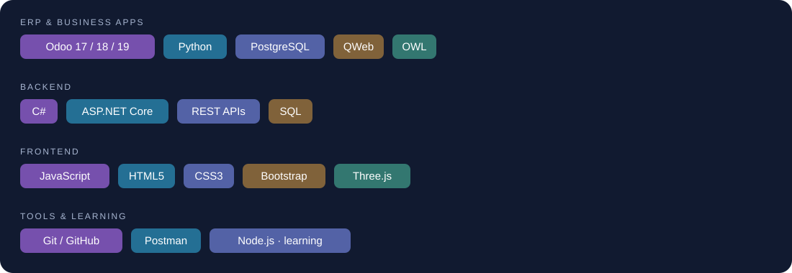

I build practical business solutions with **Python, Odoo, and PostgreSQL**, with experience across backend and full-stack development.

[Explore my projects](https://github.com/0fatma5?tab=repositories)

---

### About me

- I develop and customize **Odoo modules, business workflows, integrations, and reports**.
- My interests include **backend engineering, REST APIs, and full-stack applications**.
- I work with **Python, PostgreSQL, C#, and ASP.NET Core**.
- I'm strengthening my **JavaScript and Node.js** skills and practicing algorithms and problem solving.

### Tech stack

### Featured full-stack project

> **FAMILYHUB** · Full-stack development · Private source

**FamilyHub — Family coordination platform** · **Private project**

A multi-component personal project combining an **ASP.NET Core API**, an **Angular web application**, **Python/FastAPI and education-AI components**, and a **Flutter mobile prototype**.

This overview highlights the project's scope and technology stack. The repository and source code remain private.

### Selected public projects

| Project | Focus | Technologies |
| --- | --- | --- |
| [School Management](https://github.com/0fatma5/school-) | Personal Odoo addon for schools, students, teachers, transfers, and reports | Odoo 17, Python, PostgreSQL, OWL |
| [SkillBoost LMS](https://github.com/0fatma5/LMS) | Learning management with courses, students, and enrollment flows | C#, ASP.NET Core MVC, SQL Server |
| [Image Optimizer](https://github.com/0fatma5/Image-Optmizer) | Browser-based image optimization and editing | JavaScript, Canvas, HTML, CSS |
| [Student Exam Management](https://github.com/0fatma5/Student-Exam-Management-System) | Console-based student, exam, and results management with JSON and CSV | C#, .NET 8, LINQ |
| [FormFanz](https://github.com/0fatma5/FoRMFanzywebsite) | Interactive web graphics and creative coding | HTML, CSS, JavaScript, Three.js |
| [Image Selection Challenge](https://github.com/0fatma5/Captcha) | Frontend image-selection learning exercise | HTML, CSS, JavaScript |

### My current focus

- Deepening my knowledge of **Odoo architecture and custom development**.
- Building backend applications with **Node.js and C#**.
- Improving code quality through **testing, documentation, and clear design**.
- Practicing **problem solving in JavaScript**.
